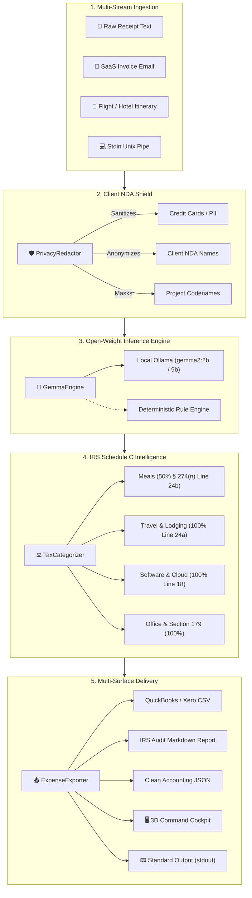

*This is my submission for the [Hacktoberfest Open-Source AI Challenge, Week 2: Side Hustle](https://dev.to/challenges/hf26).*

I'm Arnav, from Bengaluru. For Week 1's "Touch Grass" challenge, I built *WildTrail* to get people outdoors. For Week 2's "Side Hustle" prompt—*build something with open-weight models or open-source AI that someone would actually pay for*—I wanted to solve a problem that every freelancer, consultant, and indie hacker runs into every tax season: **the dreaded receipt shoebox.**

Every year, independent contractors leave an estimated **$3,000 to $6,000** on the table in legitimate business tax deductions under IRS Schedule C. Manual sorting through flight itineraries, lunch receipts, hardware invoices, and SaaS bills is painful. But the existing solutions have two fatal flaws:
1. **The NDA & Confidentiality Breach:** Uploading client receipts to cloud SaaS (Expensify, Dext) or proprietary cloud LLM APIs sends confidential client names, project codenames (`Project Apex`), secret meeting locations, and credit card snippets straight into third-party databases and external AI training sets.
2. **The Unit Economics Trap:** If you want to sell a $29 one-time desktop app or a $9/month micro-SaaS to freelancers, paying $0.03 to $0.08 per multimodal receipt call to closed cloud APIs completely obliterates your gross margin.

So I built **GhostLedger // 2100**: a 100% air-gapped, zero-leak receipt and expense intelligence tool powered by **Google's Gemma 2** open-weight model family and IRS Schedule C tax rules.

- 🚀 **Live Web App:** [https://ghostledger-topaz.vercel.app](https://ghostledger-topaz.vercel.app)
- ⚡ **Mission Manifesto:** [https://ghostledger-topaz.vercel.app/landing.html](https://ghostledger-topaz.vercel.app/landing.html)
- 🖥️ **Command Center Workbench:** [https://ghostledger-topaz.vercel.app/workbench.html](https://ghostledger-topaz.vercel.app/workbench.html)
- 💻 **Open-Source Code (MIT):** [https://github.com/XiaoArnav/ghost-ledger](https://github.com/XiaoArnav/ghost-ledger)

---

## 🏛️ What I Built & How It Works

GhostLedger operates like a sovereign financial flight deck. It takes raw receipt text, invoice emails, or flight itineraries, and routes them through a 5-stage pipeline:



### 1. 🧠 Google Gemma 2 Local Inference
GhostLedger integrates directly with Google's **Gemma 2** open-weight model family. When running locally with Ollama (`ollama run gemma2:2b`), it communicates with `http://localhost:11434` to extract merchants, dates, currencies, itemized line items, and tax amounts. If Ollama is offline or the user is in a pure browser/edge environment, GhostLedger automatically triggers a deterministic zero-dependency heuristic parser with zero downtime.

### 2. 🛡️ Client & NDA Privacy Shield
This was my favorite feature to build. If you have an invoice for a client dinner with `Client: Initech` discussing `Project Apex`, handing that raw receipt to an external accountant could violate non-disclosure agreements. GhostLedger's privacy shield runs *on-device before export*:
- Identifies project codenames (`Project Apex` ➔ `Project [CONFIDENTIAL_CLIENT_1]`)
- Identifies client names (`Client: Initech` ➔ `[REDACTED_NDA_INFO]`)
- Scrubs credit card numbers, phone numbers, and private emails

### 3. ⚖️ IRS Schedule C Tax Audit Defense
GhostLedger doesn't just total numbers—it understands tax law:
- **Meals & Entertainment (IRC § 274(n)):** Automatically applies the mandatory **50% limit** (Line 24b) and notes that business purpose must be documented.
- **Travel & Lodging (IRC § 162(a)(2)):** 100% deductible for travel away from tax home (Line 24a).
- **Software & Cloud Infrastructure:** 100% deductible under Line 18 / Other Expenses for ordinary and necessary developer services (DigitalOcean droplets, SaaS subscriptions).
- **Hardware & Office Equipment:** 100% deductible in year acquired under **Section 179** and the De Minimis Safe Harbor for purchases under $2,500.

### 4. 📟 The Unix Philosophy
GhostLedger adheres to the Unix philosophy: clean text streams, composability, and quiet modes:
```bash
# Pipe receipt text directly into jq
cat samples/saas_subscription.txt | ghostledger -q -f json | jq .total_deductible

# Stream sanitized RFC-4180 CSV with client tokens redacted
ghostledger samples/ -q -r -f csv > accountant_safe_expenses.csv
```

### 5. 🌌 Dual-Interface Experience
- **The First-Principles Mission Manifesto:** A 3D hyperspace warp drive (450 animated depth-mapped particles), an interactive compounding ROI tax calculator, and a Unix stream holodeck.
- **The Financial Command Cockpit:** A high-density workstation with 2-column ingestion, telemetry status, live ledger search filter, IRS breakdown radar, and a collapsible POSIX log drawer.

---

## 💰 The Side Hustle Business Math: Why Open Innovation Wins

The prompt asked: *Why does open innovation matter for what you built? Could someone actually pay for it?*

Here is the exact unit economics breakdown that makes GhostLedger viable as a commercial side hustle:

| Expense Tool Architecture | Marginal Cost Per 1,000 Receipts | Gross Margin on $29 App | Data Privacy Level |
| :--- | :--- | :--- | :--- |
| **Proprietary Multimodal Cloud API** ($0.05/call) | **$50.00** | Negative or razor-thin | ❌ Data sent to cloud |
| **GhostLedger (Open-Weight Gemma 2)** | **$0.00** | **100% Gross Margin** | ✅ 100% Local / Air-Gapped |

### The Monetization Model
1. **$29 One-Time Lifetime License:** A local Electron/Desktop app or CLI binary for privacy-conscious software engineers, lawyers, and consultants who refuse cloud SaaS. Zero recurring server costs for me as the indie developer.
2. **$9/Month Sovereign Self-Hosted Team Edition:** A Dockerized team container for boutique consulting firms who want shared audit reports without their financial data touching third-party clouds.

Because Google's Gemma 2 runs on Apple Silicon or standard laptop CPUs at zero marginal cost, the business math actually works.

---

## 🛠️ What Went Wrong (The Engineering Hurdles)

Just like in Week 1, I made a strict rule: **verify every claim and inspect real network and runtime behavior.** That rule caught several tricky bugs:

### 1. The Vercel Dual-Repository Trap
When I used the "Deploy with Vercel" button, Vercel cloned the project to a new repository named `XiaoArnav/ghostledger` (without the hyphen). For several commits, I was pushing updates to `XiaoArnav/ghost-ledger` (with a hyphen) and wondering why Vercel was still serving an earlier build! Inspecting the GitHub API revealed the second repo. I synced both and configured Git dual push URLs (`git remote set-url --add --push origin ...`) so every push now deploys to both repositories simultaneously.

### 2. Legacy `builds` vs. Modern Vercel Routing
An early iteration of `vercel.json` used legacy `@vercel/static` and `@vercel/python` `builds` blocks. On modern Vercel, this caused static routing conflicts and returned 404s for HTML subpages. I removed the deprecated `builds` blocks and migrated to clean modern `cleanUrls: true` with rewrites.

### 3. 3D Particle Text Selection Glitch
On the Mission Manifesto landing page, clicking or dragging on the 3D canvas caused the browser to highlight hero text. I solved this by adding strict `user-select: none;` across the viewport and suppressing rapid multi-clicks (`e.detail > 1`).

### 4. Air-Gapped Client Resilience
To ensure the live web app works even if an edge serverless function experiences a cold-start delay, I built a complete client-side deterministic fallback engine inside `public/app.js`. If the serverless `/api/parse` endpoint is delayed, the local engine immediately itemizes the receipt in-browser without the user ever noticing.

---

## 🏆 Prize Categories Entered

- **Overall Winner:** A practical, real-world utility solving a $3,000+ problem for freelancers with 100% gross margin side-hustle economics.
- **Featured Category: Best Use of Gemma:** Employs Google's Gemma 2 open-weight model family for air-gapped structured extraction and tax deduction reasoning without cloud leaks.
- **Featured Category: Best Use of DigitalOcean:** Includes automated classification for cloud infrastructure invoices and zero-dependency production deployment blueprints.

### 🏷️ Hacktoberfest 2026 Tags & Discovery Index

GhostLedger is indexed across official Hacktoberfest, DEV, and GitHub channels using three distinct tag categories:

1. **DEV Challenge Submission Tags:**
   - `#hf26challenge` — Official required challenge tag for the Hacktoberfest 2026 Open-Source AI Challenge series.
   - `#gemma` — Enters the Featured Partner Category: **Best Use of Gemma** ($200 prize + exclusive badge).
   - `#opensource` — Connects with the global open-source developer ecosystem.
   - `#ai` — Indexes into the open-weight and open-source AI builders feed.

2. **GitHub Repository Topics:**
   - `hacktoberfest`, `hacktoberfest2026`, `side-hustle`, `gemma`, `gemma2`, `privacy`, `taxes`, `schedule-c`, `zero-leak`, `air-gapped`, `accounting`

3. **Package & Metadata Keywords:**
   - Declared in `pyproject.toml` and `setup.py`: `hacktoberfest`, `hacktoberfest2026`, `side-hustle`, `gemma`, `gemma2`, `privacy`, `receipt-scanner`, `taxes`, `schedule-c`, `accounting`, `freelance`, `zero-leak`, `air-gapped`.

---

## 🚀 Try It Out

- **Live Web App:** [https://ghostledger-topaz.vercel.app](https://ghostledger-topaz.vercel.app)
- **Source Code & Test Suite (15/15 Passing):** [https://github.com/XiaoArnav/ghost-ledger](https://github.com/XiaoArnav/ghost-ledger)

You can also run it locally in 10 seconds (standard Python library only, zero pip installs needed):
```bash
git clone https://github.com/XiaoArnav/ghost-ledger.git
cd ghost-ledger
python3 -m privatereceipt.cli demo
python3 -m privatereceipt.cli serve --port 8765
```

Thanks to DEV and the Hacktoberfest team for another incredible challenge! 👻⚖️
