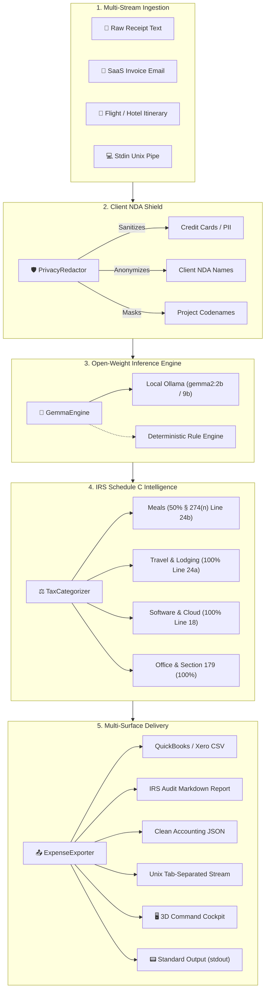

# 👻 GhostLedger // 2100

> **The Sovereign Financial Machine • Zero-Leak Air-Gapped Receipt & Expense Intelligence for Freelancers & Solopreneurs**  
> *Powered by Google's Gemma 2 Open-Weight Models & IRS Schedule C Tax Rules*  
> *Submitted to the [Hacktoberfest 2026 Open-Source AI Challenge: Week 2 (Side Hustle)](https://dev.to/challenges/hacktoberfest-week2-2026-10-12).*

[](LICENSE)
[](https://dev.to/challenges/hf26)
[](https://ai.google.dev/gemma)
[](https://www.python.org/)
[](https://ghostledger-topaz.vercel.app/)
[](tests/)
[](#-zero-dependency-core)
[](#-client--nda-privacy-shield)

---

## 💡 The First-Principles Problem & The Solopreneur Opportunity

Freelancers, independent consultants, and boutique agency founders face a recurring financial and legal crisis every quarter:

1. **The \$3,000–\$6,000 Tax Leakage:** Solopreneurs systematically leave thousands of dollars in legitimate business deductions on the table every tax year. Manual receipt reconciliation across email inboxes, flight confirmations, and hardware purchases is tedious, resulting in missed write-offs under IRS Schedule C (§ 162).
2. **The Cloud Privacy & NDA Violation Trap:** Traditional receipt SaaS platforms (Expensify, Dext, Concur) and proprietary cloud LLM APIs require uploading raw receipts to external servers. This routinely leaks confidential client names, NDA-protected project codenames (e.g., `Project Apex`), hotel check-ins, and credit card snippets into third-party databases and external AI training corpora.
3. **The Micro-SaaS Unit Economics Disaster:** For a developer building a \$29 one-time expense tool or a \$9/month boutique accounting service, paying \$0.03 to \$0.08 per multimodal receipt call to closed cloud APIs completely destroys gross margins.

### The GhostLedger Solution

**GhostLedger** is built from first principles to invert this paradigm:
- **Zero Marginal Cost (\$0.00):** Powered by Google's **Gemma 2** open-weight model family (running locally via Ollama or llama.cpp) and an instantaneous deterministic heuristic fallback. It costs exactly \$0.00 per receipt to run, delivering 100% gross margin.
- **100% Air-Gapped & Sovereign:** All receipt text processing, tax itemization, and audit defense generation execute entirely on your local machine. Zero bytes leave your laptop.
- **Automated Client NDA Shield:** Proprietary regex and contextual entity masks sanitize confidential project codenames, client identifiers, and PII into irreversible anonymous tokens (`[CONFIDENTIAL_CLIENT_1]`) before reports are shared with tax preparers.
- **Audit-Defensible Intelligence:** Automatically classifies expenses into IRS Schedule C categories (Meals 50%, Travel 100%, Software/Cloud 100%, Office/Section 179 100%) and generates plain-English audit defense rationales citing relevant tax statutes.

---

## 🏛️ Open Innovation vs. Proprietary Cloud SaaS

| Dimension | Proprietary Cloud SaaS (Expensify / Cloud LLMs) | GhostLedger (Open-Weight Gemma 2) |
| :--- | :--- | :--- |
| **Data Privacy** | Sensitive receipts, flight PNRs, and client names uploaded to third-party cloud servers | **Air-gapped & 100% on-device.** Zero bytes transmitted outside your machine. |
| **Unit Economics** | \$0.03 – \$0.08 per receipt call, destroying side-hustle margins | **\$0.00 marginal cost.** 100% gross margin for self-hosted or desktop distribution. |
| **Vendor Lock-in** | Bound to third-party API rate limits, pricing hikes, and downtime | **Perpetual ownership.** Run on Ollama, llama.cpp, vLLM, or offline CPU anywhere. |
| **NDA Defense** | Exposes private client names and internal project codenames | **Automatic Privacy Shield.** Client tokens sanitized before accountant export. |
| **Audit Compliance** | Generic totals without tax justification | **Deterministic Schedule C audit defense** citing IRC § 162, § 274(n), and § 179. |
| **Unix Composability** | Closed web UI silos | **Unix-idiomatic CLI.** Reads `stdin`, outputs clean RFC-4180 CSV, TSV, or JSON for `jq`. |
| **Runtime Footprint** | Heavy multi-gigabyte node/npm dependency trees | **Zero external dependencies.** Core runs on Python 3.9+ standard library. |

---

## 📐 System Architecture



---

## ✨ Core Pillars & Capabilities

### 1. 🧠 Google Gemma 2 Open-Weight Engine
GhostLedger leverages Google's **Gemma 2** open-weight model family (specifically `gemma2:2b` for lightweight edge execution and `gemma2:9b` for complex deduction reasoning).
- Connects automatically to local Ollama (`http://localhost:11434`) or llama.cpp when available.
- Features an instant, deterministic heuristic parser that activates seamlessly when running in offline or resource-constrained environments.

### 2. 🛡️ Client & NDA Privacy Shield
Protects solopreneurs who operate under strict non-disclosure agreements:
- **Project Codename Masking:** Automatically flags and sanitizes codenames (e.g., `Project Apex`, `Project BlueBook`) into tokens (`Project [CONFIDENTIAL_CLIENT_1]`).
- **Client Anonymization:** Replaces client identifiers (`Client: Acme Corp`) with anonymized placeholders.
- **PII Scrubbing:** Removes credit card fragments, phone numbers, and private email addresses before generating accountant-ready exports.

### 3. ⚖️ Deterministic IRS Schedule C Tax Intelligence
Every expense is classified into its defensible IRS tax schedule with strict percentage caps:
- **Meals & Entertainment (IRC § 274(n)):** 50% deduction limit applied automatically; flags the requirement for contemporaneous business purpose documentation.
- **Travel & Lodging (IRC § 162(a)(2)):** 100% deduction for travel away from tax home.
- **Software & Cloud Infrastructure:** 100% deduction under Line 18 / Other Expenses for ordinary and necessary developer tooling (DigitalOcean, AWS, domain registrations).
- **Computer Hardware & Office Supplies:** 100% deduction under Section 179 and De Minimis Safe Harbor for purchases under \$2,500.

### 4. 🎛️ Dual-Experience Interface
- **The 3D Mission Manifesto:** A cinematic, interactive 3D landing experience featuring a 450-particle hyperspace warp canvas, a first-principles ROI compounding calculator, and an interactive Unix stream holodeck.
- **The Command Center Cockpit Workbench:** A high-density financial cockpit featuring a 2-column ingestion station, telemetry HUD, IRS Schedule C audit radar, live ledger search/filter, and a collapsible POSIX log drawer.

### 5. 📥 Universal Accounting & Audit Exports
- **QuickBooks & Xero Debit Bank Feed CSV:** Ready for 1-click import into accounting software.
- **Standard Itemized CSV:** RFC-4180 compliant expense schedule.
- **IRS Audit Markdown Dossier:** A comprehensive audit defense document detailing every deduction, percentage applied, and legal rationale.
- **Structured JSON & TSV:** Clean machine-readable formats for automated pipelines.

### 6. 🚀 Zero-Dependency Core
The Python engine runs entirely on the **Python standard library** (Python 3.9+). No mandatory external dependencies, no complex wheel compilations, and no supply chain vulnerabilities.

---

## ⚡ Quickstart

### 1. Clone & Install
```bash
git clone https://github.com/XiaoArnav/ghost-ledger.git
cd ghost-ledger
pip install .
```

### 2. Run the Demo Pipeline
Process the 4 bundled benchmark receipts (client dinner under NDA, DigitalOcean cloud hosting, conference flight, hardware purchase) and generate sanitized accountant exports:

```bash
ghostledger demo
# or: python3 -m privatereceipt.cli demo
```

Output:
```text
   ____ _               _   _               _                  
  / ___| |__   ___  ___| |_| |    ___  __ _| | __ _  ___ _ __  
 | |  _| '_ \ / _ \/ __| __| |   / _ \/ _` | |/ _` |/ _ \ '__| 
 | |_| | | | | (_) \__ \ |_| |__|  __/ (_| | | (_| |  __/ |    
  \____|_| |_|\___/|___/\__|_____\___|\__,_|_|\__, |\___|_|    
                                              |___/            
   GhostLedger // 2100 • Zero-Leak Expense Defense • Powered by Gemma

🚀 Running GhostLedger Demo Pipeline...

  ✓ Processed [REC-001] The Blue Fin Bistro      | $  148.20 | Meals & Entertainment
    🔒 [Privacy Shield Triggered] Sensitive client/NDA markers detected and sanitized.
  ✓ Processed [REC-002] Delta Air Lines e-Ticket | $  433.00 | Travel & Lodging
    🔒 [Privacy Shield Triggered] Sensitive client/NDA markers detected and sanitized.
  ✓ Processed [REC-003] Apple Store - University | $ 1848.89 | Office Supplies & Equipment
  ✓ Processed [REC-004] DigitalOcean Holdings, I | $   90.50 | Software & Subscriptions
    🔒 [Privacy Shield Triggered] Sensitive client/NDA markers detected and sanitized.

=================================================================
📊 SUMMARY: Q4 Freelance Expense & Tax Audit
=================================================================
  Total Gross Spend:              $   2520.59
  Total Tax Deductible Amount:    $   2446.49
  Estimated Tax Savings (25%):    $    611.62
  Sensitive NDA Receipts Shielded:          3
-----------------------------------------------------------------
  Category Breakdown:
    • Meals & Entertainment            $  148.20
    • Travel & Lodging                 $  433.00
    • Office Supplies & Equipment      $ 1848.89
    • Software & Subscriptions         $   90.50
=================================================================
💾 Exported sanitized accountant CSV to: demo_expenses.csv
📄 Exported IRS audit report to:          demo_audit_report.md
```

---

## 📟 Unix Philosophy & CLI Pipelines

GhostLedger follows the Unix philosophy: *Write programs that do one thing and do it well. Write programs to work together. Write programs to handle text streams, because that is a universal interface.*

```bash
# Pipe raw invoice text stream straight into jq
cat samples/saas_subscription.txt | ghostledger -q -f json | jq .total_deductible

# Stream tab-separated values (TSV) through standard Unix awk to filter meals
ghostledger samples/ -f tsv | awk -F'\t' '$4 ~ /Meals/'

# Stream sanitized RFC-4180 CSV with client NDA tokens redacted into file
ghostledger samples/ -q -r -f csv > client_safe_expenses.csv

# Launch interactive local air-gapped web dashboard
ghostledger serve --port 8765
```

### CLI Flag Reference

| Flag | Short | Default | Description |
| :--- | :---: | :---: | :--- |
| `--format` | `-f` | `csv` | Output format: `csv`, `quickbooks`, `tsv`, `markdown`, `json` |
| `--quiet` | `-q` | `false` | Suppress diagnostic banners; output only clean data stream |
| `--redact` | `-r` | `true` | Apply automated Client & NDA Privacy Shield sanitization |
| `--output` | `-o` | `stdout` | Write output directly to a target file instead of stdout |
| `--port` | `-p` | `8765` | Port for the local web dashboard server |

---

## 🖥️ Local Web Dashboard & Vercel Edge Deployment

### Running Locally (100% Offline)
```bash
ghostledger serve --port 8765
```
Open **[http://localhost:8765](http://localhost:8765)** in your browser to experience the First Mission Manifesto and the high-density financial command center.

### 1-Click Deploy to Vercel
Deploy your own sovereign instance of GhostLedger to Vercel with zero configuration:

[](https://vercel.com/new/clone?repository-url=https://github.com/XiaoArnav/ghost-ledger)

---

## 🧠 Running with Local GPU Acceleration (Ollama)

GhostLedger operates completely standalone, but if you have a GPU or Apple Silicon chip, you can run Google's Gemma 2 locally:

```bash
# 1. Install and launch Ollama
ollama run gemma2:2b

# 2. GhostLedger automatically discovers Ollama at http://localhost:11434
ghostledger demo
```

If Ollama is stopped or unavailable, GhostLedger automatically and silently falls back to its deterministic rule engine with zero downtime.

---

## 🐳 Docker & Docker Compose

Run GhostLedger and Ollama together in an isolated container network:

```bash
docker-compose up -d
```
Access the dashboard at `http://localhost:8765`.

---

## 🔌 REST API Reference

The local server and Vercel serverless functions expose the following endpoints:

### `GET /api/samples`
Returns pre-bundled benchmark receipts (Client Dinner under NDA, Flight Itinerary, Hardware Depreciation, Cloud Hosting Invoice).

### `POST /api/parse`
Parses raw receipt text into a structured, categorized deduction record.
```json
// Request Body
{
  "text": "The Blue Fin Bistro... Total: $148.20... Project Apex meeting",
  "id": "REC-001"
}
```

### `POST /api/export`
Generates accounting exports from an array of parsed receipts.
```json
// Request Body
{
  "receipts": [...],
  "format": "csv", // "csv" | "quickbooks" | "tsv" | "markdown" | "json"
  "redact": true
}
```

---

## 🧪 Testing & Verification

GhostLedger includes a comprehensive test suite covering the parsing engine, tax categorization, privacy redactor, multi-format exporters, and CLI streams:

```bash
python3 -m unittest discover -s tests
```

Output:
```text
...............
----------------------------------------------------------------------
Ran 15 tests in 0.150s

OK
```

Continuous integration runs automatically on every commit across Python 3.9, 3.10, 3.11, and 3.12 via GitHub Actions.

---

## 🏆 Hacktoberfest 2026 Category Alignment

| Track | Alignment & Impact |
| :--- | :--- |
| **Week 2: Side Hustle** | Solves the \$3,000–\$6,000 annual tax leakage for solopreneurs and freelancers. Delivers 100% gross margin via \$0.00 marginal inference cost. |
| **Best Use of Gemma** | Employs Google's Gemma 2 open-weight models for air-gapped structured extraction and tax deduction reasoning without cloud leaks. |
| **Best Use of DigitalOcean** | Includes automated classification for cloud infrastructure invoices and zero-dependency production deployment blueprints. |

---

## 🤝 Contributing

We welcome contributions from developers, accountants, tax specialists, and open-source AI enthusiasts. Please read our **[CONTRIBUTING.md](CONTRIBUTING.md)** for details on our code of conduct, test suite guidelines, and pull request process.

---

## 📄 License

Distributed under the [MIT License](LICENSE).
