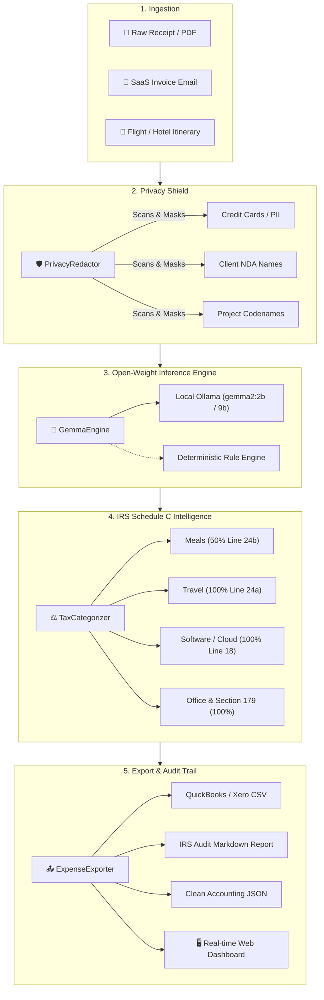

# 👻 GhostLedger // 2100

> **Zero-Leak Local Receipt & Expense Defense for Freelancers • Powered by Gemma 2**  
> *Submitted to the [Hacktoberfest 2026 Open-Source AI Challenge: Week 2 (Side Hustle)](https://dev.to/challenges/hacktoberfest-week2-2026-10-12).*

[](LICENSE)
[](https://dev.to/challenges/hf26)
[](https://ai.google.dev/gemma)
[](https://www.python.org/)
[](https://vercel.com/new/clone?repository-url=https://github.com/XiaoArnav/ghost-ledger)

---

## 💡 The Problem & The Side Hustle Opportunity

Freelancers, contractors, and boutique agencies face a recurring nightmare during tax season:
1. **Missed Deductions:** Solopreneurs leave an average of \$3,000 to \$6,000 on the table every year in ordinary and necessary business expenses because manual receipt sorting is tedious.
2. **Confidentiality & NDA Leaks:** Sending receipts to cloud SaaS tools (Expensify, Dext, or proprietary cloud LLM APIs) leaks confidential client names, NDA project codenames, secret meeting attendees, and credit card snippets to external servers and model training pipelines.
3. **Crushing Unit Economics:** For a developer building a \$29 one-time expense app or a \$9/month micro-SaaS, paying \$0.03 to \$0.08 per multimodal receipt call to closed cloud APIs destroys gross margin.

**GhostLedger solves this completely.** It runs locally on your machine using **Google's Gemma 2** open-weight model family (or local heuristics). Receipts never leave your laptop, client NDA names are automatically sanitized before handing reports to your accountant, and operating cost is exactly **\$0.00**.

---

## 🏛️ Why Open Innovation Matters

| Dimension | Proprietary Cloud APIs | PrivateReceipt (Open-Weight Gemma 2) |
| :--- | :--- | :--- |
| **Data Privacy** | Sensitive receipts, flight PNRs, and client names uploaded to third-party cloud servers | **Air-gapped & 100% on-device.** Zero bytes transmitted outside your machine. |
| **Unit Economics** | Per-token API fees scale with every receipt, killing SaaS margins | **Zero marginal cost.** 100% gross margin for desktop or self-hosted software. |
| **Vendor Lock-in** | Bound to vendor rate limits, pricing hikes, and downtime | **Perpetual ownership.** Run on Ollama, llama.cpp, or vLLM anywhere. |
| **Audit Compliance** | Black-box output without tax justification | **Deterministic Schedule C audit defense** generated alongside every deduction. |

---

## 📐 System Architecture



---

## ✨ Features

- **🧠 Gemma 2 Extraction:** Extracts merchant, date, currency, line items, and tax breakdown.
- **🛡️ Client & NDA Privacy Shield:** Detects project codenames (e.g., `Project Apex`) and client names (`Client: Acme`), replacing them with anonymous tokens (`[CONFIDENTIAL_CLIENT_1]`) before exporting for tax preparers.
- **⚖️ IRS Schedule C Audit Defense:** Automatically applies deduction rules (e.g., 50% for meals, 100% for software and travel) and attaches a defensible plain-English audit rationale.
- **📊 Real-time Dashboard:** Built-in zero-dependency web interface with live metric cards, category breakdown, and one-click exports.
- **📥 Universal Accounting Exports:**
  - Standard Itemized CSV
  - QuickBooks / Xero compatible debit bank feed CSV
  - Full IRS Tax Audit Markdown Report
  - Structured JSON
- **🚀 Zero-Dependency Core:** Runs out-of-the-box with standard Python 3.9+. No mandatory node, npm, or heavy framework dependencies required.

---

## ⚡ Quickstart

### 1. Clone & Setup
```bash
git clone https://github.com/XiaoArnav/ghost-ledger.git
cd ghost-ledger
```

### 2. Run the Demo Pipeline
Process the bundled sample receipts (client dinner under NDA, DigitalOcean cloud hosting, conference flight, hardware purchase) and generate sanitized accountant exports:

```bash
ghostledger demo
# or: python3 -m privatereceipt.cli demo
```

Output:
```text
   ____ _               _   _               _                  
  / ___| |__   ___  ___| |_| |    ___  __ _| | __ _  ___ _ __  
 | |  _| '_ \ / _ \/ __| __| |   / _ \/ _` | |/ _` |/ _ \ '__| 
 | |_| | | | | (_) \__ \ |_| |__|  __/ (_| | | (_| |  __/ |    
  \____|_| |_|\___/|___/\__|_____\___|\__,_|_|\__, |\___|_|    
                                              |___/            
   GhostLedger // 2100 • Zero-Leak Expense Defense • Powered by Gemma

🚀 Running GhostLedger Demo Pipeline...

  ✓ Processed [REC-001] The Blue Fin Bistro      | $  148.20 | Meals & Entertainment
    🔒 [Privacy Shield Triggered] Sensitive client/NDA markers detected and sanitized.
  ✓ Processed [REC-002] Delta Air Lines e-Ticket | $  433.00 | Travel & Lodging
    🔒 [Privacy Shield Triggered] Sensitive client/NDA markers detected and sanitized.
  ✓ Processed [REC-003] Apple Store - University | $ 1848.89 | Office Supplies & Equipment
  ✓ Processed [REC-004] DigitalOcean Holdings, I | $   90.50 | Software & Subscriptions
    🔒 [Privacy Shield Triggered] Sensitive client/NDA markers detected and sanitized.

=================================================================
📊 SUMMARY: Q4 Freelance Expense & Tax Audit
=================================================================
  Total Gross Spend:              $   2520.59
  Total Tax Deductible Amount:    $   2446.49
  Estimated Tax Savings (25%):    $    611.62
  Sensitive NDA Receipts Shielded:          3
-----------------------------------------------------------------
  Category Breakdown:
    • Meals & Entertainment            $  148.20
    • Travel & Lodging                 $  433.00
    • Office Supplies & Equipment      $ 1848.89
    • Software & Subscriptions         $   90.50
=================================================================

💾 Exported sanitized accountant CSV to: demo_expenses.csv
📄 Exported IRS audit report to:          demo_audit_report.md
```

### 3. Unix Philosophy & CLI Pipelines
GhostLedger follows the Unix philosophy: do one thing well, compose cleanly via text streams (`stdin`/`stdout`), and separate data from diagnostics:

```bash
# Pipe receipt text stream straight into jq
cat samples/saas_subscription.txt | ghostledger -q -f json | jq .total_deductible

# Filter meals using standard Unix awk on TSV stream
ghostledger samples/ -f tsv | awk -F'\t' '$4 ~ /Meals/'

# Stream sanitized RFC-4180 CSV with client NDA tokens redacted
ghostledger samples/ -q -r -f csv > client_safe_expenses.csv

# Launch interactive 3D local dashboard
ghostledger serve --port 8765
```

### 4. Interactive 3D Web Dashboard
```bash
ghostledger serve --port 8765
```
Open [http://localhost:8765](http://localhost:8765) to drag-and-drop receipts or images, inspect 3D interactive tilt cards and point clouds, toggle the NDA Privacy Shield, and download audit-ready files.

### 5. Running with Local Ollama (Optional)
To use local GPU acceleration with Gemma 2:
```bash
# Pull and serve Gemma 2 locally
ollama run gemma2:2b
```
GhostLedger automatically connects to `http://localhost:11434` when Ollama is running, and gracefully falls back to its deterministic rules engine when offline.

---

## 🧪 Testing

Run the full automated test suite:
```bash
python3 -m unittest discover -s tests
```

---

## 🏆 Hacktoberfest 2026 Category Qualifications

- **Overall Winner:** A practical, real-world utility solving a \$3,000+ problem for freelancers with monetizable side-hustle viability.
- **Best Use of Gemma:** Uses the Gemma open-weight model family for air-gapped, zero-leak information extraction and tax reasoning.
- **Best Use of DigitalOcean:** Cloud infrastructure invoice classification and production deployment blueprints.

---

## 📄 License

Distributed under the [MIT License](LICENSE).
